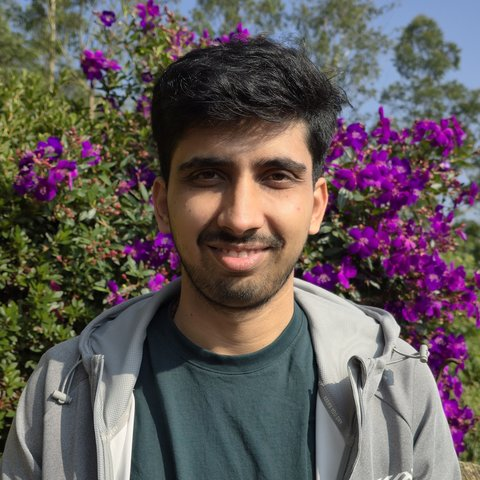

+++
title = "About Me"
aliases = ["about"]
+++

Hi, I'm Dipesh. I'm a PhD student at the National University of Singapore, in the [VERSE Lab](https://verse-lab.org), advised by [Ilya Sergey](https://ilyasergey.net).

I'm interested in programming languages, formal verification and systems programming. These days I'm working on getting verified, efficient systems code out of Lean, and maintaining and improving [Velvet](https://velvetprover.dev), a multi-modal verifier in Lean.

Before my PhD, I was a backend software engineer at Uber. Before that, I interned at IIT Madras (verifying an OCaml garbage collector in F\*), Tarides (parallel incremental computation library in OCaml) and CDAC Bangalore (GCC optimizations).

Reach out to me at [dipesh.kaphle111@gmail.com](mailto:dipesh.kaphle111@gmail.com) or [dipesh@u.nus.edu](mailto:dipesh@u.nus.edu). My CV is [here](/cv.pdf).

## News

{{ news() }}
